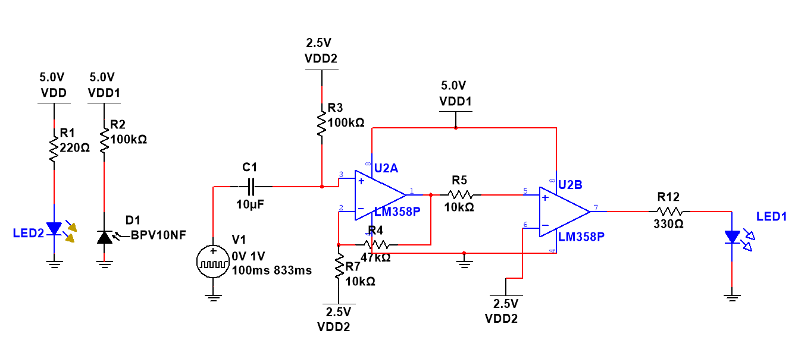
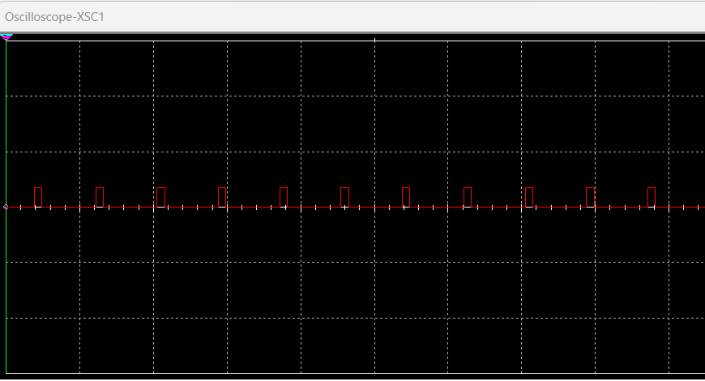
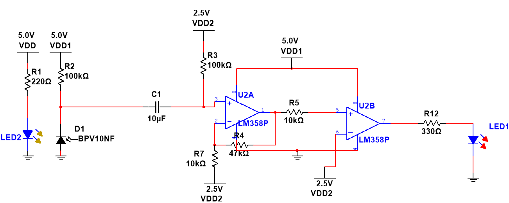
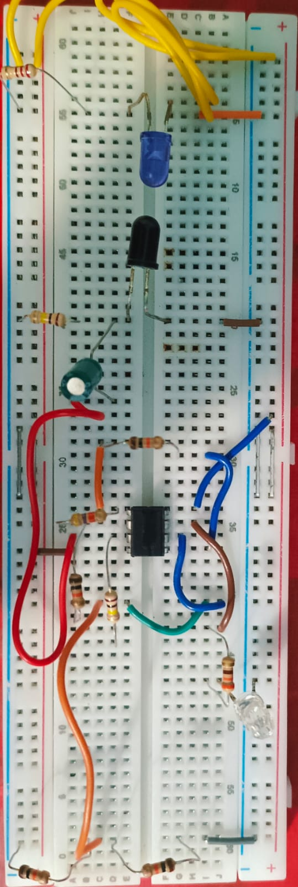
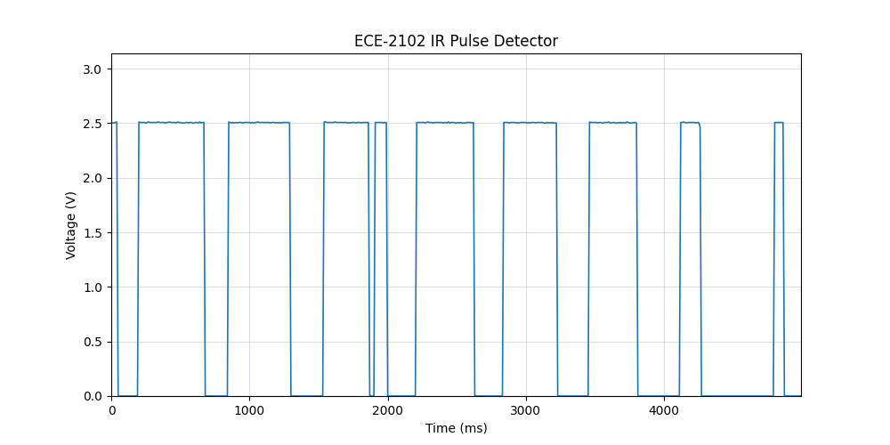

<div align="center">

# 🫀 IR-Based Optical Pulse & Heart-Rate Detector
### **ECE 2102: Open-Ended Electronics Project**
**Department of Electrical and Electronic Engineering (EEE)**  
*Khulna University of Engineering & Technology (KUET) · October 2026*

[](LICENSE)
[](SECURITY.md)
[](https://www.arduino.cc/)
[](https://www.ni.com/en/shop/electronic-test-instrumentation/application-software-for-electronic-test-and-instrumentation-category/what-is-multisim.html)
[](https://kuet.ac.bd/)

<p align="center">
  <b>An end-to-end photoplethysmography (PPG) system demonstrating optical sensor interfacing, multi-stage analog signal conditioning with LM358 op-amps, comparator pulse shaping, Multisim simulation, and real-time DAQ waveform visualization via Arduino & Python.</b>
</p>

</div>

---

> [!IMPORTANT]
> **Educational Prototype Notice:** This system was designed and developed as an open-ended university laboratory project for academic and demonstration purposes. It is **not** a certified medical diagnostic instrument.

---

## 📑 Table of Contents

- [Overview & Objectives](#-overview--objectives)
- [Working Principle (PPG)](#-working-principle-ppg)
- [System Architecture](#-system-architecture)
- [Component Inventory](#-component-inventory)
- [Circuit Stages & Analysis](#-circuit-stages--analysis)
- [NI Multisim Simulation](#-ni-multisim-simulation)
- [Arduino & Python DAQ Oscilloscope](#-arduino--python-daq-oscilloscope)
- [Experimental Results & Calculations](#-experimental-results--calculations)
- [Gallery & Hardware Captures](#-gallery--hardware-captures)
- [Limitations & Future Enhancements](#-limitations--future-enhancements)
- [Repository Structure](#-repository-structure)
- [Getting Started](#-getting-started)
- [License & Security](#-license--security)

---

## 🎯 Overview & Objectives

Photoplethysmography (PPG) is a non-invasive optical technique that detects blood volume changes in microvascular beds of tissue. This project implements a complete electronic signal-processing pipeline that transforms minuscule optical variations across a fingertip into clean, quantifiable digital switching transitions and real-time electrical waveforms.

### Key Objectives
1. **Optical Detection:** Detect pulsatile blood volume variations across human fingertip tissue using infrared illumination.
2. **Transduction:** Convert small optical flux variations into microampere photocurrent using a high-speed PIN photodiode (**BPV23NF**).
3. **Multi-Stage Amplification:** Amplify the sub-millivolt physiological AC component while establishing a stable DC operating bias using **LM358** operational amplifiers.
4. **Comparator Pulse Conversion:** Digitize the amplified analog waveform into square pulses using an op-amp/comparator threshold stage.
5. **Physical Pulse Indication:** Drive an LED indicator corresponding to cardiac cycle transitions.
6. **Data Acquisition & Live Plotting:** Capture node voltages via an **Arduino Uno (100 Hz / 10 ms interval)** and plot live dynamic waveforms via **Python (Matplotlib & PySerial)**.
7. **Heart Rate Estimation:** Compute pulse repetition period ($T$) and extrapolate estimated Beats Per Minute ($\text{BPM}$).

---

## 🔬 Working Principle (PPG)

The heart pumps blood through arterial vessels in rhythmic cycles. During cardiac systole, blood volume in capillary beds peaks, absorbing more infrared light. During diastole, blood volume drops, permitting higher infrared transmission to the photodetector.

```
       [ Infrared LED (940 nm) ]
                 │
                 ▼
       [ Human Fingertip Tissue ]  <--- Pulsatile blood volume absorption
                 │
                 ▼
       [ BPV23NF PIN Photodiode ]  <--- Generates light-dependent photocurrent
                 │
                 ▼
       [ LM358 Pre-Amplifier ]     <--- AC amplification & DC operating point
                 │
                 ▼
       [ LM358 Conditioning ]      <--- Secondary gain & band-limiting filter
                 │
                 ▼
       [ Comparator Stage ]        <--- Compares to 2.5V reference threshold
                 │
       ┌─────────┴─────────┐
       ▼                   ▼
[ Indicator LED ]    [ Arduino A0 DAQ ]
(Visual Pulse)       (Python Plotter GUI)
```

1. **Infrared Illumination:** A high-efficiency IR LED continuously transmits infrared light through the tissue.
2. **Pulsatile Variation:** Arterial blood expansion modulates the transmitted light; the AC pulsatile component accounts for roughly 1–2% of the overall optical signal.
3. **Optical-to-Electrical Conversion:** The **BPV23NF** photodiode receives the modulated light, generating a proportional photocurrent.
4. **Amplification & Filtering:** LM358 dual op-amps isolate the low-frequency cardiac pulses ($0.5\,\text{Hz} - 4\,\text{Hz}$ / $30 - 240\,\text{BPM}$), stripping high-frequency noise and baseline drift.
5. **Threshold Detection:** A voltage comparator compares the conditioned waveform against an adjustable reference (nominally $2.5\,\text{V}$) to generate clean binary pulses.

---

## 🧩 Component Inventory

| Component | Part / Spec | Role in Project |
| :--- | :--- | :--- |
| **Infrared Emitter** | 5mm IR LED ($\lambda \approx 940\,\text{nm}$) | Emits consistent IR radiation through fingertip tissue |
| **Photodetector** | **BPV23NF** PIN Photodiode | High-speed, IR-sensitive silicon photodiode with daylight filter |
| **Operational Amplifiers** | **LM358** (Dual Low-Power Op-Amp) | Multi-stage amplification, active filtering, and comparator switching |
| **Threshold Reference** | $2.5\,\text{V}$ Voltage Divider | Stable midpoint comparison threshold for binary pulse shaping |
| **Visual Indicator** | 5mm High-Efficiency Red LED | Blinks synchronously with detected pulse cycles |
| **Passive Elements** | Precision Resistors & Capacitors | Sets stage gain, RC high-pass/low-pass cutoffs, and bias currents |
| **Power Supply** | $5.0\,\text{V}$ Regulated DC Source | Powers analog front-end and optoelectronics |
| **Microcontroller** | **Arduino Uno** (ATmega328P) | 10-bit ADC sampling on analog pin `A0` at 100 Hz |
| **Host PC** | Python 3.8+ (PySerial & Matplotlib) | Dynamic waveform rendering, autoscaling, and data logging |

---

## ⚡ Circuit Stages & Analysis

```
 +5V ──[ 150Ω ]──>| IR LED ──> [Fingertip] ──> BPV23NF ──> [Stage 1 Amp] ──> [Stage 2 Filter] ──> [Comparator] ──┬──> [LED]
                                                                                                                   └──> [Arduino A0]
```

### 1. Stage 1: Transimpedance / Pre-Amplification
- Converts the minute reverse photocurrent from the photodiode into a proportional voltage signal.
- Implements capacitive AC coupling to remove large ambient DC sunlight/room-lighting offsets while centering the signal around an established operating bias.

### 2. Stage 2: Secondary Amplification & Active Bandpass
- Provides supplementary closed-loop gain ($A_v$) to raise the physiological signal to volt-level swing.
- Implements low-pass filtering to attenuate $50\,\text{Hz}/60\,\text{Hz}$ mains hum and high-frequency fluorescent noise.

### 3. Stage 3: Comparator & Threshold Shaping
- Compares the analog cardiac wave against a reference voltage (nominally $2.5\,\text{V}$).
- Translates sinusoidal analog crests into crisp rectangular logic pulses ($\approx 0\,\text{V}$ to $2.5\,\text{V}-5\,\text{V}$) suitable for driving the indicator LED and digital counters.

---

## 💻 NI Multisim Simulation

The design was mathematically modeled and verified using **National Instruments Multisim 14** before physical breadboarding.

- **Schematic File:** [`simulation/ECE-2102-Project.ms14`](simulation/ECE-2102-Project.ms14)
- **Functional Validation:** Utilized a `PULSE_VOLTAGE` source to simulate repeating physiological pulses and analyze op-amp gain margins, slew rate limitations, transient responses, and threshold hysteresis.

| Simulation Schematic | Simulated Pulse Response |
| :---: | :---: |
|  |  |

---

## 📊 Arduino & Python DAQ Oscilloscope

To analyze dynamic waveforms without relying solely on bulky benchtop equipment, an integrated digital oscilloscope was created:

```
[ Analog Circuit Node ] ──> [ Arduino Uno Pin A0 ] ──(USB 115200 Baud)──> [ Python Real-Time Plotter ]
```

### Acquisition Parameters
| Parameter | Value | Description |
| :--- | :--- | :--- |
| **Input Channel** | `A0` | 10-bit Successive Approximation ADC ($0 - 5\,\text{V}$) |
| **Sampling Frequency** | $100\,\text{Hz}$ | Governed by `sampleIntervalUs = 10000` ($10\,\text{ms}$) |
| **Buffer Window** | 500 samples | $5.0\,\text{seconds}$ rolling observation frame |
| **Protocol Framing** | `BEGIN` ... `END` | Delimited ASCII transmission ensuring frame synchronization |
| **Baud Rate** | $115,200\,\text{bps}$ | High-throughput serial transfer minimizing transmission latency |

---

## 📈 Experimental Results & Calculations

During laboratory testing with a human subject's finger held steady on the optical cradle, a periodic switching signal was recorded:

### Quantitative Waveform Parameters
| Metric | Measured Value | Remarks |
| :--- | :--- | :--- |
| **Waveform Period ($T$)** | **$0.650\,\text{s}$** | Peak-to-peak interval of consecutive pulses |
| **HIGH Duration ($t_{\text{high}}$)** | **$380\,\text{ms}$** | Comparator output HIGH (active phase) |
| **LOW Duration ($t_{\text{low}}$)** | **$270\,\text{ms}$** | Comparator output LOW |
| **Signal Amplitude** | $0\,\text{V} \leftrightarrow 2.5\,\text{V}$ | Logic levels across the observation node |
| **Estimated Heart Rate** | **$92.3\,\text{BPM}$** | Computed from $60 / T$ |

### Mathematical Formulation
$$\text{Frequency } (f) = \frac{1}{T} = \frac{1}{0.650\,\text{s}} \approx 1.538\,\text{Hz}$$

$$\text{Estimated Heart Rate (BPM)} = f \times 60 = \frac{60}{T} = \frac{60}{0.650} \approx \mathbf{92.3\text{ BPM}}$$

> [!NOTE]
> **Engineering Note on Waveform Morphology:**  
> The $380\,\text{ms}$ HIGH and $270\,\text{ms}$ LOW durations correspond to the electrical threshold crossing times of the comparator stage. They must **not** be confused with anatomical systolic and diastolic durations, which require raw analog PPG morphological analysis (dicrotic notch, anacrotic phase) prior to threshold quantization.

---

## 🖼️ Gallery & Hardware Captures

| Circuit Schematic | Physical Breadboard Prototype |
| :---: | :---: |
|  |  |

| Signal Flowchart | Hardware Oscilloscope Output |
| :---: | :---: |
|  |  |

*(Additional oscilloscope captures available in [`hardware/oscilloscope/`](hardware/oscilloscope/))*

---

## ⚠️ Limitations & Future Enhancements

### Current System Limitations
- **Motion Artifacts:** Finger movement alters optical distance, causing baseline wander and false triggers.
- **Ambient Light Sensitivity:** Photodiode responds to fluctuating room lighting (fluorescent flicker) if unshielded.
- **Fixed Comparator Threshold:** Variations in skin pigmentation or finger thickness may require recalibrating the reference potentiometer.
- **Sampling Resolution:** The $100\,\text{Hz}$ Arduino sampling rate introduces a $\pm 10\,\text{ms}$ timing quantization uncertainty.

### Proposed Future Improvements
- [ ] 3D-printed optical enclosure to shield against ambient light.
- [ ] Adaptive digital peak detection running directly on the microcontroller.
- [ ] Active twin-T notch filter to suppress $50\,\text{Hz}$ powerline noise.
- [ ] I2C OLED display for standalone BPM readout without requiring a computer.

---

## 📂 Repository Structure

```plaintext
ECE-2102-KUET/
│
├── docs/                                   # Academic documentation and reports
│   ├── ECE 2102 Project Proposal.pdf       # Initial project proposal
│   └── ECE 2102 Project Report.pdf         # Comprehensive final report
│
├── hardware/                               # Circuit diagrams and prototype captures
│   ├── Circuit_Diagram.png                 # Master circuit schematic
│   ├── IR Pulse Sensor Flowchart.png       # Optical-to-electrical signal flowchart
│   ├── Real_Circuit_Image.jpeg             # Photograph of physical circuit breadboard
│   └── oscilloscope/                       # Benchtop oscilloscope measurements
│       ├── Oscilloscope_Output_01.png
│       ├── Oscilloscope_Output_02.png
│       └── Oscilloscope_Output_03.png
│
├── simulation/                             # NI Multisim simulation workspace
│   ├── ECE-2102-Project.ms14               # Multisim design file
│   ├── Circuit_Diagram_Simulation.png      # Simulated schematic capture
│   └── Simulated_Pulses.png                # Simulated output waveforms
│
├── software/                               # Real-time oscilloscope integration
│   ├── Arduino_Oscilloscope/
│   │   └── Arduino_Oscilloscope.ino        # Arduino firmware (100 Hz sampling on A0)
│   ├── arduino_oscilloscope.py             # Python real-time GUI plotter
│   └── requirements.txt                    # Python package dependencies
│
├── .gitignore                              # Git exclusion rules
├── LICENSE                                 # MIT Open-Source License
├── README.md                               # Project documentation
├── SECURITY.md                             # Security policy & electrical safety notice
└── Details.md                              # Comprehensive design & analysis notes
```

---

## 🚀 Getting Started

### 1. Prerequisites
- [Arduino IDE](https://www.arduino.cc/en/software) (v2.0+ recommended)
- [Python 3.8+](https://www.python.org/downloads/)
- [NI Multisim](https://www.ni.com/en/shop/electronic-test-instrumentation/application-software-for-electronic-test-and-instrumentation-category/what-is-multisim.html) (v14.0 or compatible, for `.ms14` simulation)

### 2. Microcontroller Setup
1. Connect your **Arduino Uno** to your computer via USB.
2. Wire the pulse detector output to Arduino pin **`A0`**, and connect circuit **`GND`** to Arduino **`GND`**.
3. Open [`software/Arduino_Oscilloscope/Arduino_Oscilloscope.ino`](software/Arduino_Oscilloscope/Arduino_Oscilloscope.ino) in Arduino IDE.
4. Select your Board (`Arduino Uno`) and Port, then click **Upload**.

### 3. Launching the Real-Time Plotter
1. Navigate to the `software` directory:
   ```bash
   cd software
   ```
2. Install the required Python packages:
   ```bash
   pip install -r requirements.txt
   ```
3. Verify your Arduino COM port in [`software/arduino_oscilloscope.py`](software/arduino_oscilloscope.py):
   ```python
   PORT = "COM3"  # Change to your active port (e.g., COM4, /dev/ttyUSB0)
   ```
4. Run the visualizer:
   ```bash
   python arduino_oscilloscope.py
   ```
5. Place your fingertip gently over the IR emitter/detector cradle and watch the real-time pulse waveform render dynamically on screen!

---

## 📜 License & Security

- **License:** This project is licensed under the **MIT License** — see the [LICENSE](LICENSE) file for complete details.
- **Security & Safety:** For reporting issues or reviewing electrical precautions, please read [SECURITY.md](SECURITY.md).

---

<div align="center">
  <sub>Developed for <b>ECE 2102</b> · Department of EEE · Khulna University of Engineering & Technology (KUET)</sub>
</div>
